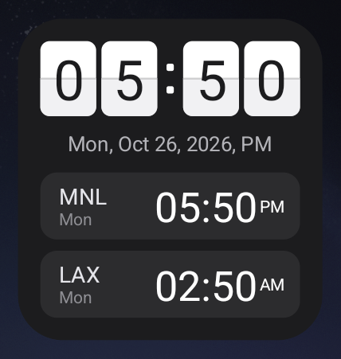
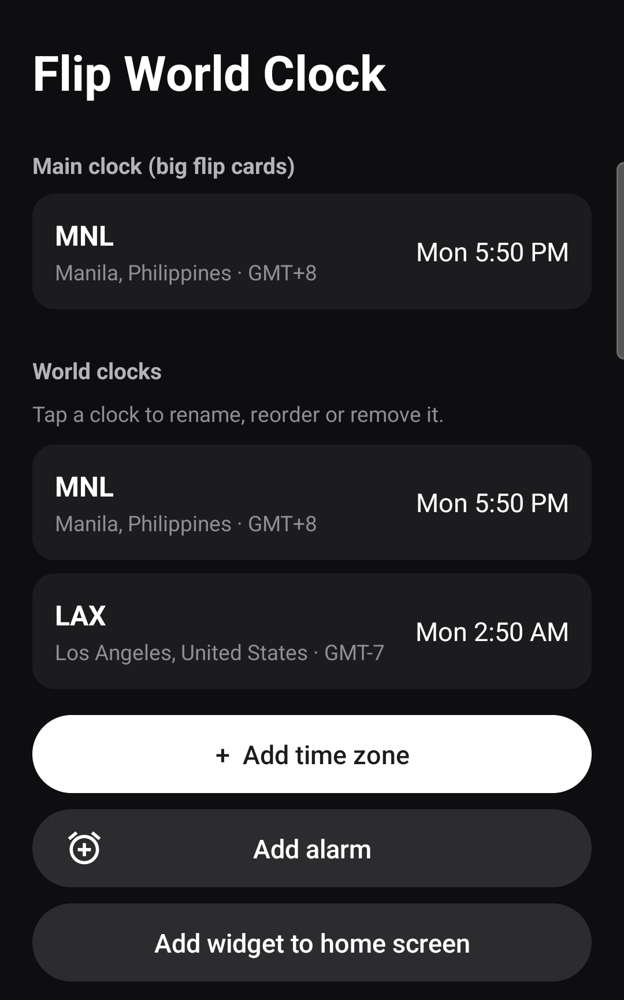
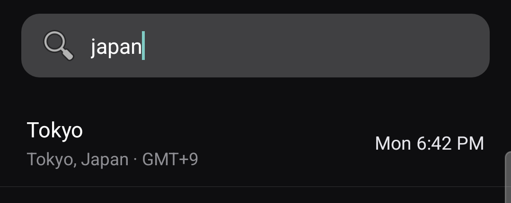

# Flip World Clock

Free and open source ([MIT](LICENSE)). An Android home-screen widget: a flip-card clock for your main time zone, with rows for any
other world clocks you add underneath. Made for keeping Manila time on the big cards with
Los Angeles (work) time a glance away, but any city in the world works.

<p>
  
  &nbsp;
  
</p>

## Features

- **Flip-card clock** for your main time zone, with the date and AM/PM underneath.
- **World clock rows** for as many cities as you like. Each row shows a short label
  (e.g. `LAX`), that city's weekday and its time, so you can see when somewhere is already
  tomorrow or still yesterday.
- **Any city or country.** Search by city, country or time-zone name ("japan",
  "los angeles", "pacific").
- **Add alarm** button on the settings screen that opens your phone's Clock app on its
  new-alarm screen.
- **No battery cost.** Every clock is an Android `TextClock` pinned to a time zone, so the
  launcher keeps it ticking itself. There's no background service and no polling, and
  daylight saving time is handled for you.

## Install

1. Download the latest `FlipWorldClock-*.apk` from
   [Releases](https://github.com/abbysimple/worldclock-widget/releases/latest).
2. Open it on your phone. If Android asks, allow installs from your browser or file app.
3. Open **Flip World Clock** and tap **Add widget to home screen**, or long-press the home
   screen → **Widgets** → **Flip World Clock**.

Requires Android 8.0 or newer.

## Using it

Tap the widget (or open the app) to get to the settings screen.

| To… | Do this |
| --- | --- |
| Add a world clock | **+ Add time zone**, search, tap the city |
| Change the big flip-card zone | Tap the **Main clock** card and pick a city |
| Rename a row (e.g. to `LAX`) | Tap the row → **Rename** (up to 10 characters) |
| Reorder rows | Tap the row → **Move up** / **Move down** |
| Make a row the main clock | Tap the row → **Use as main clock** |
| Remove a row | Tap the row → **Remove** |
| Set an alarm | **Add alarm** |

Changes show on the widget straight away. At the default 2×2 size the widget fits about
three rows; for more, long-press it and drag it taller.



New rows get a short airport-style code for well-known cities (LAX, NYC, LON, TYO, SIN…);
other cities get the first three letters of their name. Rename them however you like.

## Build

```powershell
.\build-apk.ps1            # -> build\WorldClockWidget.apk
.\build-apk.ps1 -Install   # also installs over adb
```

The script calls the SDK tools directly (aapt2, javac, d8, zipalign, apksigner), so no
Gradle daemon is needed. It needs JDK 17+, `ANDROID_HOME` (defaults to `C:\Android\sdk`),
build-tools 35.0.0 and platform android-36. The Gradle files are there for building in
Android Studio.

Builds are signed with the local Android debug key. That's fine for installing on your own
phone, but an APK built on a different machine has a different key, so Android won't
install it over this one. Uninstall the old app first.

## How it works

| File | What it does |
| --- | --- |
| `WorldClockWidget.java` | Widget provider: points the layout's `TextClock`s at the saved zones and adds one row per world clock |
| `Clocks.java` | Saved setup (main zone + rows) in SharedPreferences; city/country names, GMT offsets and default labels from ICU |
| `SettingsActivity.java` | Settings screen; also the widget's configure screen (setup and long-press → Settings) |
| `ZonePickerActivity.java` | Searchable list of every city time zone |
| `res/layout/widget.xml` | Widget layout. Each flip card clips a two-digit `TextClock` to one half, with letter spacing that centres each digit on its card |

## License

[MIT](LICENSE). Free to use, modify and share, including in your own apps.
